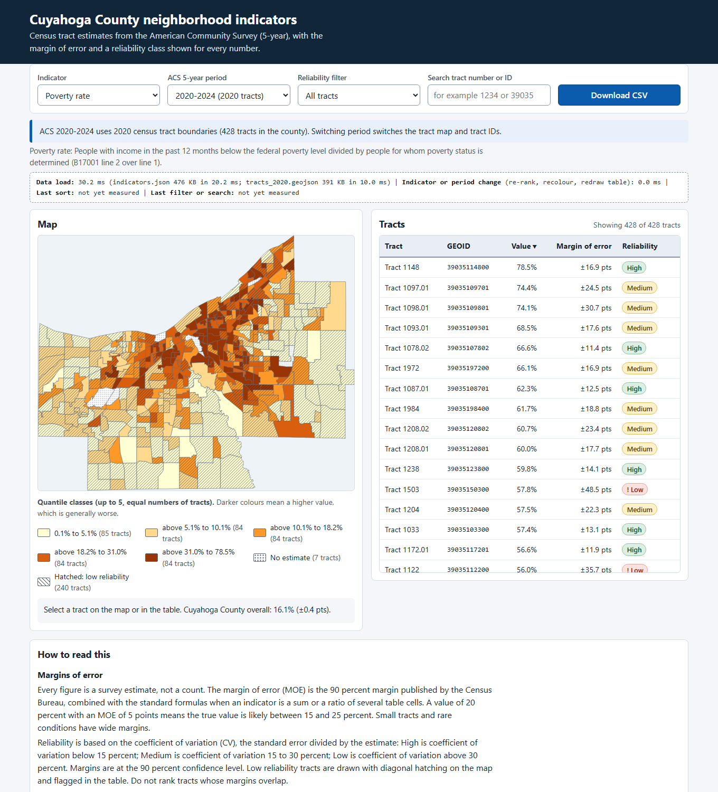
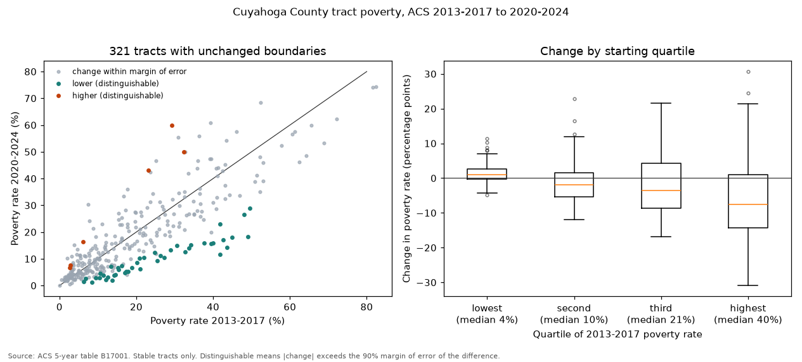
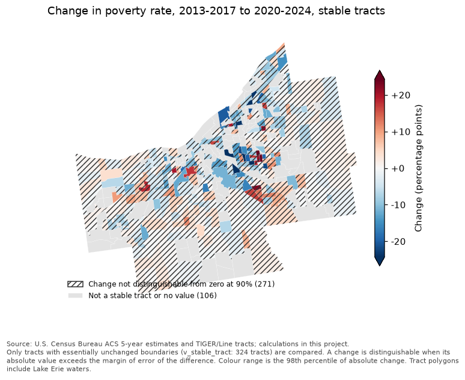

# Did poverty really fall in Cuyahoga County neighborhoods, or is it just noise in the survey?

County-wide, the American Community Survey (ACS) says the share of people below the poverty line in Cuyahoga County (Cleveland, Ohio) went from 18.3% in 2013-2017 to 16.1% in 2020-2024. Neighborhood maps made from the same survey look like a story of change block by block. I wanted to know how much of that tract-level story the margins of error actually support, and I wanted to build the small database, indicator definitions, maps and web page that a community data center would use to ask the question properly.

**Live viewer:** https://pranavmalhotra05-dev.github.io/cuyahoga-neighborhood-indicators/ (pick an indicator and period, see the tract map and a sortable table, download CSV).



## Short answers

All numbers come from `outputs/analysis_numbers.json` and the other files under `outputs/`, produced by `src/09_analysis.py` and the scripts around it.

- **At county level the decline is real.** Poverty fell 2.23 points (margin of error of the difference 0.58). Median household income rose 4,679 dollars in 2024 dollars (margin 892), from 59,789 to 64,468. Unemployment, vacancy, adults without a diploma and rent burden also moved by more than their margins; the single-parent share, the renter share and median age did not.
- **At tract level most of the change cannot be separated from noise.** I compared the 321 tracts with unchanged boundaries and a poverty estimate in both periods. The median margin of error of a tract's change is 10.1 points. Only 50 tracts (15.6%) show a change larger than its margin: 44 down, 6 up. For another 184 tracts the point estimate fell and for 137 it rose.
- **A single tract poverty estimate is wide.** For 2020-2024 the median 90% margin of error is 7.0 points and 57.0% of tracts have a coefficient of variation above 0.30. Among the 20 tracts with the highest estimated poverty, 10 have an interval that reaches below the 90th-percentile cut-off of 44.0%, so a ranking of the "poorest" tracts is partly a ranking of luck.
- **The biggest drops are partly an artifact.** The tracts with the highest starting poverty (median 39.8%) fell a median 7.6 points. A simulation that adds only sampling noise to the 2013-2017 values and assumes no true change produces a median change of -2.5 points in that top quartile, because tracts picked for being high in noisy data tend to be lower the next time. Part of the drop is real (the tract-to-tract rank correlation between periods is 0.83), but roughly a third of it is what noise alone would give.
- **The tracts I can compare are not a random sample.** Census tract boundaries were redrawn in 2020 (447 tracts in 2010, 428 in 2020). Only 324 pairs are essentially unchanged. The 100 tracts of 2020 that are new or changed have median poverty of 19.4%, against 12.4% for the unchanged ones. The tract-level result describes the stable, less poor part of the county.




## What is in the database

Two ACS 5-year vintages (2013-2017 on 2010 tracts, 2020-2024 on 2020 tracts), 13 tables (B01002, B01003, B11003, B15003, B17001, B19013, B23025, B25002, B25003, B25004, B25044, B25070, B25077), 157 cells for each of 447 and 428 tracts and for the county, each with its margin of error: 137,689 fact rows in DuckDB. Fifteen indicators are defined as data (which cells form numerator and denominator) and computed in SQL views with Census margin-of-error formulas: poverty, median household income, rent burden at 30% and 50%, vacancy, other vacant units, renter share, median home value, households without a vehicle, no high school diploma, bachelor's degree or more, unemployment, single-parent families, population, median age. See [docs/indicator_definitions.md](docs/indicator_definitions.md), [docs/technical_standards.md](docs/technical_standards.md) and [docs/data_dictionary.md](docs/data_dictionary.md).

`sql/04_checks.sql` runs 47 checks (row counts, joins, ranges, margin-of-error sanity, tract counts of 447 and 428 against the Census relationship file and TIGER/Line, and reconciliation of tract sums to published county totals). Current result in [outputs/data_quality_report.md](outputs/data_quality_report.md): 41 PASS, 0 FAIL, 6 informational rows. Missing and suppressed cells are kept as NULL with a reason flag: 32 null estimates in 2013-2017 and 54 in 2020-2024; 69 and 124 tract indicator values end up unavailable.

## Geocoding

I took 300 open public schools from the NCES Common Core of Data (directory year 2024, via the Urban Institute Education Data API, retrieved 2026-11-20) and sent their street addresses to the Census Geocoder batch endpoint. 295 matched (98.3%: 274 exact, 21 non-exact) and 5 did not. Against the coordinates the school directory itself supplies, the geocoder landed in the same 2020 tract for 289 of 295 (98.0%; 98.5% for exact, 90.5% for non-exact), with a median distance of 95 m. Schools are easy addresses (real street numbers, mostly on named streets), so this match rate is an upper bound for household addresses. Details: [outputs/geocode_report.md](outputs/geocode_report.md).

## Web viewer and speed

Static HTML, CSS and JavaScript in `web/`, drawing the tract polygons itself (no tile service). Measured in the built-in browser (script time, not paint): page data load about 50 ms, indicator change median 3.0 ms, sort median 2.8 ms. A small FastAPI app (`src/app.py`) serves the same data from DuckDB live: 50 requests, median 15.8 ms, p95 21.7 ms. The database has only about 138 thousand rows, so these say little about large databases ([outputs/query_timing.md](outputs/query_timing.md)).

## Shell automation

`scripts/refresh.sh` runs the whole pipeline (download, ingest, build, checks, spatial checks, geocoding, maps, web export, analysis) with a log and a non-zero exit on any failure; with data already downloaded and geocoding cached it took 23.5 s in Git Bash on Windows. `scripts/backup.sh` writes a hashed, verified, rotated archive and can restore it. See [docs/shell_automation.md](docs/shell_automation.md).

## Independent check

`tests/independent_recompute.py` recomputes the key numbers (county rates, margins, change counts, tract counts, reconciliation) straight from the raw Census files without the database or the project's SQL. Its results are in [outputs/independent_review.md](outputs/independent_review.md).

## Limits

- Two vintages only. The ACS 5-year periods do not overlap, so the margin of the difference assumes independent samples.
- "Distinguishable" is a 90% screening rule used over hundreds of tracts, so a few false signals are expected, and non-signals are not proof of no change.
- Tract comparison covers only tracts whose boundaries did not change materially, and these are less poor than the rest.
- The regression-to-the-mean simulation is a rough size estimate, not a correction.
- The Census API now needs a key, so I used the bulk summary files; they are the same published tables.
- Dollar comparisons use the CPI-U ratio, an approximation of the ACS inflation adjustment.
- The school sample says little about geocoding household addresses.
- Maps draw TIGER polygons as published, which extend into Lake Erie; six tracts with almost no residents (parks, airport, lake) have no values.

## Reproduce

```
pip install -r requirements.txt
bash scripts/refresh.sh            # or: SKIP_GEOCODE=1 bash scripts/refresh.sh
bash scripts/run_server.sh         # optional FastAPI server
```

About 750 MB of Census files are downloaded the first time (`data/source_manifest.csv` lists URL, size, hash and date). The Census Geocoder and the Education Data API are called by `src/05_geocode.py` unless `SKIP_GEOCODE=1`.

## Data and license

Code is MIT. Data are public: U.S. Census Bureau ACS and TIGER/Line, BLS CPI-U, NCES Common Core of Data via the Urban Institute Education Data Portal. Not an official statistic of any agency.
